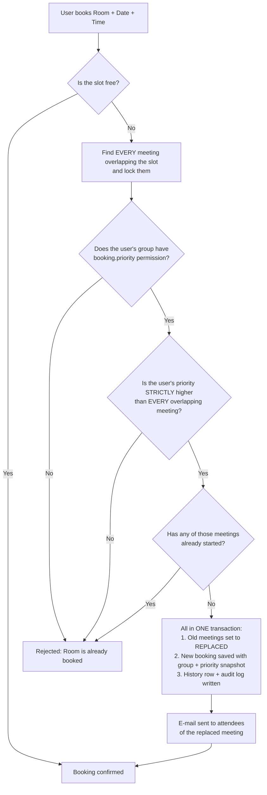

# Booking Priority: How It Works (Demo Guide)

This guide covers the group-based booking priority added in commit `e8f5447`:
*"Add group management, booking priority, dashboard, invitations and Entra sync"*.

---

## 1. The idea

Every employee belongs to a **group**, and every group has a **priority number**.

> **Priority 1 is the highest.** A smaller number outranks a bigger one.

If you try to book a room that is already taken, the app checks priorities.
If your group outranks the meeting already in the room, you get the room and
the earlier meeting is marked **Replaced**. If it doesn't, the booking is
rejected as before.

---

## 2. Default groups

| Group      | Priority | Can replace lower bookings? |
|------------|:--------:|:---------------------------:|
| Leadership | **1**    | Yes |
| HR         | **2**    | Yes |
| Manager    | **3**    | Yes |
| TL         | **4**    | Yes |
| Employee   | **5**    | Yes (but nobody ranks lower) |
| Admin      | **5**    | Yes (but nobody ranks lower) |
| *No group* | lowest active (5) | **Never** |

- An admin can change priorities and permissions in **Group Management**.
- The ability to replace other bookings comes from the **`booking.priority`**
  permission on the group. Turn it off and that group can no longer replace
  anyone, whatever its number.
- Employees with no group rank the same as the **lowest** active group and
  can **never** replace anyone.

---

## 3. The flow



### The same flow in plain steps

1. **User picks** a room, date and time.
2. **Slot free?** The booking is confirmed. No priority check is needed.
3. **Slot taken?** The system finds *every* meeting overlapping the time,
   partial overlaps included, and locks those rows.
4. The system reads the user's **current group from the database**. It never
   trusts a priority sent by the browser.
5. The booking goes ahead only if **all three** of these are true:
   - the group has the `booking.priority` permission,
   - the user's priority is **strictly higher** (a smaller number) than
     **every** overlapping meeting,
   - **none** of those meetings has started yet.
6. If they are, in a single transaction:
   - each old meeting changes to **PREEMPTED**, which users see as **"Replaced"**,
   - the new booking is saved with a **snapshot** of the organizer's group and priority,
   - a row is added to `booking_priority_history` (append-only) and to the audit log.
7. After commit, the replaced meeting's attendees get an **e-mail**.
8. Both bookings show who replaced whom and why (`BumpedDetails` and the dashboard).

---

## 4. The rules in one line each

| Rule | What it means |
|------|---------------|
| **Lower number wins** | Priority 1 beats 2, 2 beats 3, and so on. |
| **Must be strictly higher** | Equal priority means the first booking stays. |
| **Must beat everyone** | If one overlapping meeting ranks equal or higher, the whole request is rejected. |
| **Started meetings are safe** | A meeting in progress is never replaced. |
| **Snapshot at booking time** | A booking keeps the priority it had when it was made. Later group changes don't affect it. |
| **No group means no replacing** | Unassigned users rank lowest and can't replace anyone. |
| **Replaced is final** | A replaced meeting doesn't come back by itself. |
| **All-or-nothing** | A recurring series either books every occurrence or none. |

---

## 5. Demo examples

Setup for every example: **Room "Everest", 5 Nov 2026**.

### Example 1: Higher priority replaces a lower one ✅

| | Who | Group (priority) | Time |
|---|---|---|---|
| Existing | Ravi | Employee (5) | 10:00 – 11:00 |
| New request | Meena | Manager (3) | 10:00 – 11:00 |

- Does Manager have `booking.priority`? Yes.
- Is 3 strictly higher than 5? Yes.
- Has Ravi's meeting started? No.

**Result:** Meena's booking (#102) is confirmed. Ravi's booking (#101) becomes
**Replaced**, and Ravi and his attendees get an e-mail.

History / reason stored:
```
Replaced by Manager booking #102: priority 3 outranks 5
```

---

### Example 2: Lower priority can't replace a higher one ❌

| | Who | Group (priority) | Time |
|---|---|---|---|
| Existing | Meena | Manager (3) | 10:00 – 11:00 |
| New request | Arun | TL (4) | 10:00 – 11:00 |

4 is lower than 3, so **Arun is rejected** with *"Room is already booked for
the selected time slot"*. Meena's meeting doesn't change.

---

### Example 3: Equal priority, first booking wins ❌

| | Who | Group (priority) | Time |
|---|---|---|---|
| Existing | Priya | HR (2) | 14:00 – 15:00 |
| New request | Kavin | HR (2) | 14:00 – 15:00 |

Equal priority is not *strictly* higher, so **Kavin is rejected**.

---

### Example 4: Partial overlap with several meetings

The request has to beat **every** meeting it overlaps.

Existing meetings in Everest:

| Booking | Who | Group (priority) | Time |
|---|---|---|---|
| #201 | Ravi | Employee (5) | 10:00 – 11:00 |
| #202 | Meena | Manager (3) | 11:00 – 12:00 |

**4a. TL Arun (4) asks for 10:30 – 11:30** ❌
It overlaps both. It beats Ravi (5) but not Meena (3), so the **whole
request is rejected** and nothing changes.

**4b. Leadership Suresh (1) asks for 10:30 – 11:30** ✅
It beats both (1 < 5 and 1 < 3). **#201 and #202 are both Replaced**, and
two history rows point to Suresh's booking.

---

### Example 5: A started meeting is never replaced ❌

Ravi (Employee, 5) has 10:00 – 11:00. At **10:15**, Leadership Suresh (1)
asks for 10:30 – 11:30.
Ravi's meeting has **already started**, so Suresh is rejected even though
his priority is higher.

---

### Example 6: The snapshot keeps old bookings unchanged

1. On 1 Nov, Arun is in **Employee (5)** and books Everest 16:00 – 17:00
   on 5 Nov. The booking stores `priority_at_booking = 5`.
2. On 3 Nov, an admin moves Arun to **Manager (3)**.
3. On 4 Nov, TL Divya (4) asks for Everest 16:00 – 17:00 on 5 Nov.

The system compares against the **stored snapshot (5)**, not Arun's current
group. 4 beats 5, so **Divya gets the room** and Arun's booking is replaced.
Bookings Arun makes from now on carry priority 3.

---

### Example 7: Employee with no group ❌

Neha has **no group** (for example, a new joiner not yet mapped by the Entra sync).
She can still create, view and cancel her own bookings, but:
- her priority is the **lowest active group's** (5),
- `canPreempt = false`, so she **can never replace anyone**, even a meeting
  with no snapshot.

---

### Example 8: Recurring series is all-or-nothing

Manager Meena books Everest **every Monday 10:00 – 11:00 for 4 weeks**.

| Week | Existing meeting | Outcome |
|---|---|---|
| 1 | free | ok |
| 2 | Employee (5) | can replace |
| 3 | free | ok |
| 4 | **HR (2)** | can't replace |

One occurrence can't be taken, so **the entire series is rejected** with
*"Room is already booked for one or more occurrences"*, and the clashing dates
are listed. Week 2's Employee meeting **is not** replaced.

---

## 6. What users see

| Screen | What shows |
|---|---|
| **Available rooms** | Rooms that look busy but that the user's group *could* take are still listed (`getClaimableRooms`). |
| **Replaced booking** | Status **"Replaced"**, plus who took it, their group, the meeting type and the reason. |
| **New booking** | A list of the bookings it replaced. |
| **E-mail** | Attendees of the replaced meeting are told it was replaced. |
| **Dashboard (HR / Admin)** | Replaced-booking details, exportable as CSV / XLSX / PDF. |

---

## 7. Where it lives in the code

| Concern | File |
|---|---|
| Who the user is: group, priority, permissions | [lib/services/group-context.service.ts](lib/services/group-context.service.ts) |
| Find holders, `canBumpAll`, release, record history | [lib/services/priority.service.ts](lib/services/priority.service.ts) |
| Booking transaction that calls the above | [lib/services/booking.service.ts](lib/services/booking.service.ts) |
| "Replaced by" / "Replaced" details | [lib/services/bump-info.service.ts](lib/services/bump-info.service.ts) |
| Default groups and permissions | [db/seed-groups.ts](db/seed-groups.ts) |
| Tables: `groups`, `user_groups`, `group_permissions`, `booking_priority_history` | [db/schema.ts](db/schema.ts), [drizzle/0027_groups_priority.sql](drizzle/0027_groups_priority.sql) |
| Permission keys (`booking.priority`, …) | [lib/constants.ts](lib/constants.ts) |

### The core check (simplified)

```ts
// priority.service.ts
canBumpAll(holders, claimant) =
  holders.length === 0 ||
  (claimant.canPreempt &&
   holders.every(h =>
     h.priority > claimant.priority &&   // strictly lower priority (bigger number)
     !meetingHasStarted(h)))             // not already in progress
```
